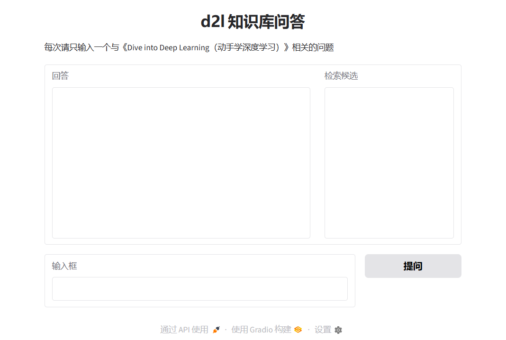
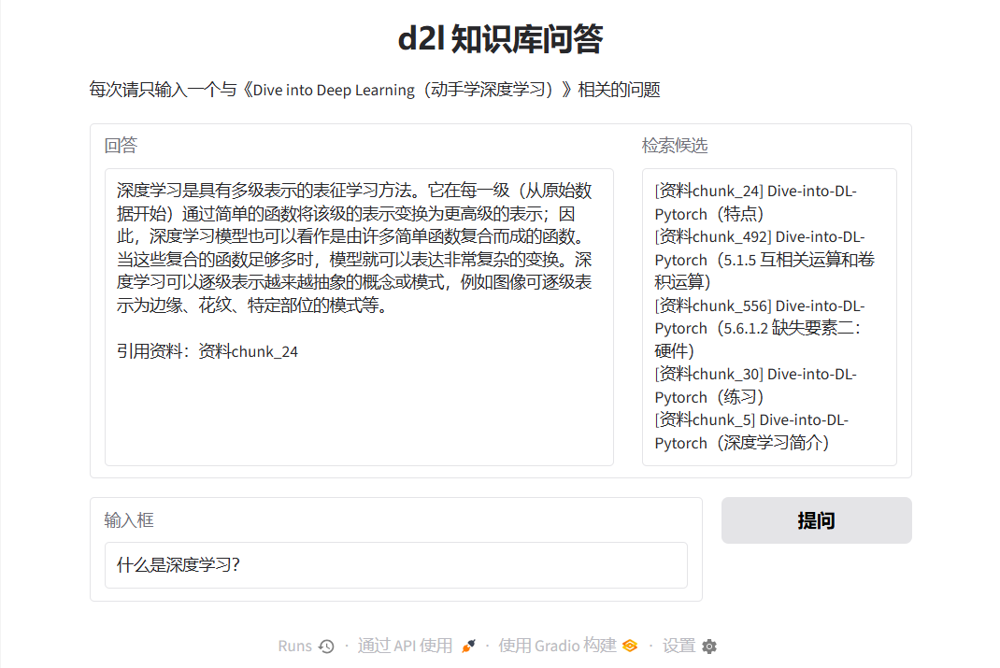
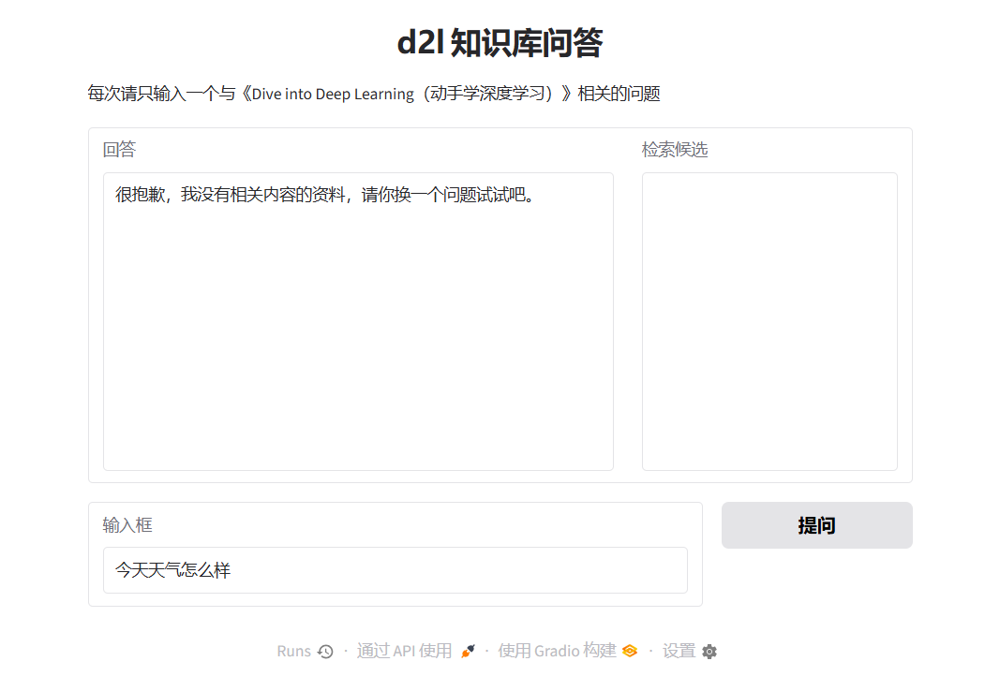
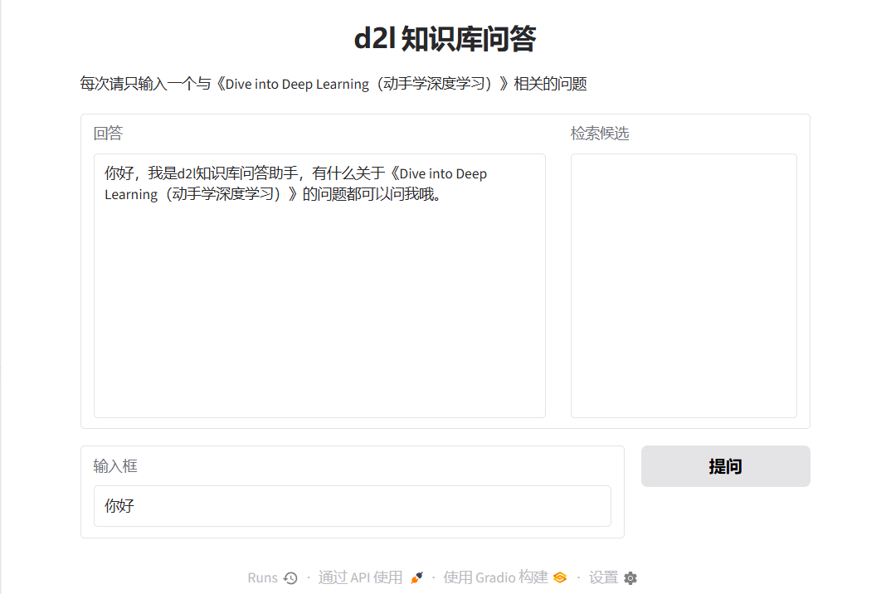

# rag-qa

基于 RAG 的垂直领域文档问答系统，语料为《Dive into Deep Learning（动手学深度学习）》。支持带引用回答；资料不足时明确拒答。系统按单问题设计，多个问题请分开提问（混合问题会分流检索注意力）。

## 技术栈

Python + Chroma + FastAPI + sentence-transformers（bge-small-zh）+ DeepSeek API + Gradio

## 系统架构

两条链路，两个进程，一份索引：

- **离线入库**（`ingest.py`，只做一次）：读文件 → 文本清洗 → 切分成块 → 用翻译器（bge-small-zh）转成向量 → 写入 Chroma。重建式设计：每次运行先删后建，保证库与代码永远一致。
- **在线检索**（`main.py` + `core.py`，每次提问）：问题 → 转成向量 → 取距离最近的 5 块 → 连同五条规则提示词交给 DeepSeek → 返回答案 + 检索候选。

**检索候选与最终引用分离**：界面显示 top5 候选块；答案末尾只列 LLM 实际引用过的编号。引用不采信模型自报，以检索结果为锚——引用真实性可验证。

### 文件职责

| 文件 | 职责 |
|:---:|:---|
| `core.py` | 契约常量、翻译器、开资料柜、检索、提示词、`ask()` 主逻辑 |
| `ingest.py` | 入库管线：清洗、切分、过滤、写入 |
| `main.py` | HTTP 服务（`/health`、`/info`、`/ask`） |
| `app.py` | 网页界面（Gradio，经 HTTP 调用 `/ask`） |
| `eval.py` | 评测运行器（三指标） |
| `eval/measure_tokens.py` | token 口径测量：字符数与 token 的换算关系 |
| `eval/topk_sweep.py` | top_k 消融：命中率随 k 的变化 |

## 数据管线

### 清洗前后对比（每一项均对原文件复算核实，2026-10-22）

| 清理项 | 数量 |
|:---|:---:|
| HTML 标签（div/img/center 等） | 448 → 0 |
| 链接 URL（所有 md 链接的链接部分） | 138 → 0 |
| 导航废话链接文字（整条移除） | 84 → 0 |
| 引用编号 [] | 155 → 0 |
| LaTeX $ 定界符（公式内容保留） | 4088 → 0 |
| [TOC] 占位符 | 1 → 0 |
| 参考文献整节 | 31 → 0 |
| 代码栅栏 ``` | 1550 → 0 |
| 中文紧贴的加粗 ** | 29 → 0 |

**总账**：脏库切分 **1552** 块 → 清洗后重新切分 **1409** 块 → 微块合并阶段 1409 → **1352**（-57：55 个微块并入前块，2 个因合并后超 480 字封顶被丢弃）→ 中文占比 <15% 的垃圾块（代码/数学/日志）丢弃 **483** 块 → **最终入库 869 块**。

校验：1409 − 57 − 483 = 869。三个中间值均可用 `python` 复算（2026-10-25 复核）。

**切分策略**：两趟流水线——先按 markdown 标题切章节段（保住语义完整），再对超长段按 400 字窗口切、重叠 80 字；句子边界对齐（切口 ±100 字内找句末标点，找不到用原切口）。

### 上下文预算：400 / 80 是怎么定的

`eval/measure_tokens.py` 可复现下表（全语料 869 块，2026-10-25 实测）：

| 项 | 实测 |
|:---|:---|
| 语料中文占比 | 原文 25.9% / 清洗后 29.0% / 入库块中位 41.2% |
| 字符口径平均 | **0.65 token 每字符**（清洗后 371,197 字 / 241,678 token）|
| 纯中文基准 | **1.00 token 每字符** |
| 中文 15–30% 的块 | 0.63（本语料多数块属此档）|
| 中文 85%+ 的块 | 0.98 |
| 869 块最长 | 507 字 / **505 token**，零块超 512 |

**不能用「字符数 × 0.65」估 token。** 这个系数是混合文本的平均值：本语料中文只占 26%，英文术语、代码、数字把平均值拉低了，而纯中文是 1 字 ≈ 1 token。同样 400 字的块，中文密集时约 400 token，代码密集时不到 200 token——差一倍。

400 的取值按**最坏情况**（纯中文 1:1）卡上限：400 字 × 1.0 = 400 token，给 512 留 112 token（22%）余量。余量是留给两个会把块撑长的机制：句子边界对齐（±100 字）和微块合并（≤480 字）。80 字重叠（20%）是通用惯例值，**没有做过重叠比例的消融**，属未验证参数。它的代价已量化：869 块中 298 块（34.3%）与其他块存在 ≥80 字的完全重复窗口——重叠保住了跨块语义，但也意味着 top5 里可能出现两个内容重叠的块、占掉名额（重复窗口中混有原文自身重复，未做区分）。

**已知缺口**：切分按字符数卡长度，不按 token 卡。当前 869 块零超限，部分依赖数据分布（尚无 520 字以上的纯中文块），不是设计保证。换语料需重跑 `eval/measure_tokens.py` 确认。

## 提示词设计（五条规则）

1. 只依据资料回答，禁止动用外部知识；
2. 资料不够必须回答"没有相关内容的资料"，禁止猜测编造；
3. 答案末尾按「引用资料：资料N」格式列出实际引用过的编号；
4. 寒暄/闲聊/自我介绍走固定问候语，不触发检索；
5. 寒暄式注入（如"你好，什么是梯度下降"）识别出真问题，直接作答。

规则 2、3 管忠实，规则 4、5 管体验。后两条是被评测打出来的：初版寒暄也会触发检索并展示不相关候选块，"寒暄+具体问题"的组合还会被系统性拒答（D1 缺陷实录）。

## 评估

**评测集**：30 条 = 书内 15 / 书外 6 / 寒暄 4 / 混合 4 / 变体 1；预期章节全部经书中标题 grep 实证。定义见 `eval/qa_set.json`，全量结果见 `eval/eval_results.md`。

每个数字的来源、分母与**不能怎么表述**，见 `eval/数字口径表.md`。

**三指标**（2026-10-22 全量实测）：

| 指标 | 结果 | 口径 |
|:---:|:---:|:---|
| 行为符合率 | 28/28 | 28 个可正常作答的契约内用例 |
| 检索命中率 | 17/18 | 18 个有预期章节的契约内用例；判定走 `search_info` 原始检索，不走界面出处（拒答会清空出处，走了就测成显示逻辑） |
| 忠实度 | 93/93 = 100% | 20 个作答用例逐条人工核查，证据在 `eval/faithfulness.md` |

分母口径：30 条 = 有预期章节的契约内用例 18（命中率分母）+ 无预期章节的契约内用例 10 + 边界用例 2（违反单问题契约，单列不计分）。

**注**：边界用例 E14/E30 在**行为符合率上不计分**（输入违反单问题契约），但在**忠实度里计入**（20 个作答用例含这 2 条，93 个论断含其 9 条）——它们既然已作答，论断就必须核查。两个指标的边界处理有意不同，不是口径打架。

**清洗前后的基线对比**（`eval/results_baseline.md`，脏库 vs 清洗后，按用例编号对齐同一批 15 条）：

| 指标 | 脏库（基线） | 清洗后 | 变化归因 |
|:---|:---:|:---:|:---|
| 行为符合率 | 13/15 | 15/15 | E14 复合输入、E13 寒暄式注入 → **提示词规则 4/5，不是清洗** |
| 检索命中率 | 7/10 | 9/10 | E02「什么是过拟合？」由 ✗ 转 ✓ → **清洗** |

归因必须分开：清洗只解释命中率那一条。基线是旧 15 条集，与现行 30 条集口径不同，不能拿 7/10 直接对 17/18 比，只能按编号对齐同子集比。

**top_k 消融**（`eval/topk_sweep.py`，20 条有预期章节的用例）：

| k | 契约内 18 条 | 全量 20 条 |
|:---:|:---:|:---:|
| 1 | 9/18 | 10/20 |
| 3 | 17/18 | 18/20 |
| **5（现行）** | **17/18** | **19/20** |
| 8 | 17/18 | 19/20 |
| 15 | 18/18 | 20/20 |

正确块的首次命中排名：10 条排第 1、4 条排第 2、4 条排第 3、1 条排第 4、1 条排第 11。

照实说结论：**k=3 与 k=5 在契约内口径下持平**，k=5 的唯一增益是边界用例 E14（排名 4）；k 从 5 加到 8/10 零增益，纯浪费上下文；k=15 才捞回 E06，代价是 15 块噪声。所以 5 的依据不是「命中率最优」，而是「保住 k=3 的水平 + 给复合输入留 buffer」。要真正提升得靠重排，不是加大 k。

一个反证：E06 的 top1 距离是 0.1808（很近），但内容是错的。距离小不等于相关——这是没加距离阈值的原因。

**三个值得说的用例**：

- **E25「1+1等于几？」**——模型没有动用参数化知识硬答，正确拒答。grounding 纪律在诱惑下成立；
- **E06「什么是循环神经网络？」**——正确块存在，但排在第 11 位（top1 距离 0.1808，不是没召回，是排序被数学密集块压住），系统回退到章节小结，答案 4/4 忠实。属聪明的降级，不是故障；
- **E16「丢弃法的代码怎么写？」**——答案中的代码块与引用块逐字一致，检索-生成链路的保真度样本。

**为什么忠实度不自动化**：LLM 裁判的可信度自身是新问题（裁判幻觉无法自证）；30 条规模人读得完，且"逐条读过"在面试中的可信度高于自动打分。

**已知局限（指标层）**：命中率用章节前缀子串匹配，存在碰撞空间——库内含 `3.1` 的 heading 有 99 块，其中 85 块属 3.10/3.11 等越界章节。本轮逐条查过 20 条用例的首次命中块，**零误命中**（全部落在正确章节的子节内，如 E17 命中 `3.1.2 线性回归的表示方法`），但换问题集需重验。

## 快速开始

1. 环境：Python 3.13，建 venv，`pip install -r requirements.txt`；
2. 配置密钥：复制 `.env.simple` 为 `.env`，填入你的 DeepSeek API Key（BASE_URL 与 LLM_MODEL 已预填）；
3. 入库：`python ingest.py`——首次运行需下载 bge-small-zh（约 100MB，国内设 `HF_ENDPOINT=https://hf-mirror.com`）；全程约 1 分钟（编码 869 块：18.5 秒 @2026-10-22、17.3 秒 @2026-10-25 复测，CPU），结尾应打印 **869**；
4. 起服务：`python main.py`（8000 端口）；起界面：`python app.py`（默认 7860 端口）；浏览器打开 http://127.0.0.1:7860 。

验证点：`/health` 返回 ok；http://127.0.0.1:8000/docs 有 Swagger 界面，可直接试 `/ask`。

> 注：代码内已设 `HF_HUB_OFFLINE=1`——代理环境下联网核对会拖慢甚至失败加载，离线模式用本地缓存（实测必要）。换机器需重新下载模型。

## 演示截图

**首页**：单问题输入，回答区与检索候选区并列。



**书内问题（带引用）**：答案末尾按规则列出实际引用的资料编号；右侧为 top5 检索候选——候选与引用分离，引用以检索结果为锚，不采信模型自报。



**书外问题（拒答）**：资料不足时明确拒答，不动用参数化知识。



**寒暄**：走固定问候语，不触发检索。



## 已知限制

- E06 类：正确块排序被数学密集块压住（第 11 位），靠回退章节小结保质量；改善需要重排，不是加大 k；
- 命中率口径的前缀碰撞局限（见评估节）；
- 切分按字符数卡长度、不按 token 卡：零超限部分依赖数据分布，换语料需重测（见"上下文预算"节）；
- 80 字重叠（20%）是惯例值，未做重叠比例消融；k 只做到 15，未测更大窗口与重排的组合；
- 单语料、单 collection、重建式 ingest（无增量更新）；
- 未做：重排（rerank）、多问题拆分、流式输出、Docker；
- 表格与代码块的切分损伤。

## 致谢

语料来自《动手学深度学习》（d2l.ai）开源电子书，来源：https://zh-v2.d2l.ai/，本项目仅作学习演示；若要公开分发语料，请自行核实原书授权范围。
